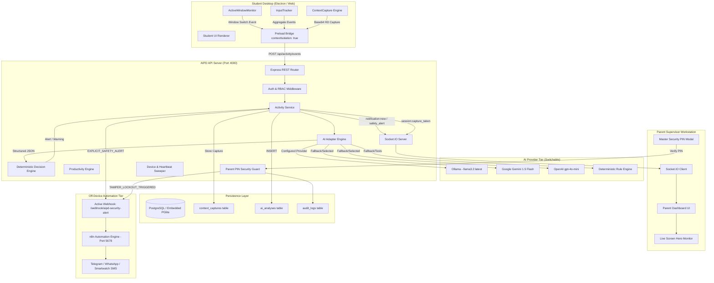
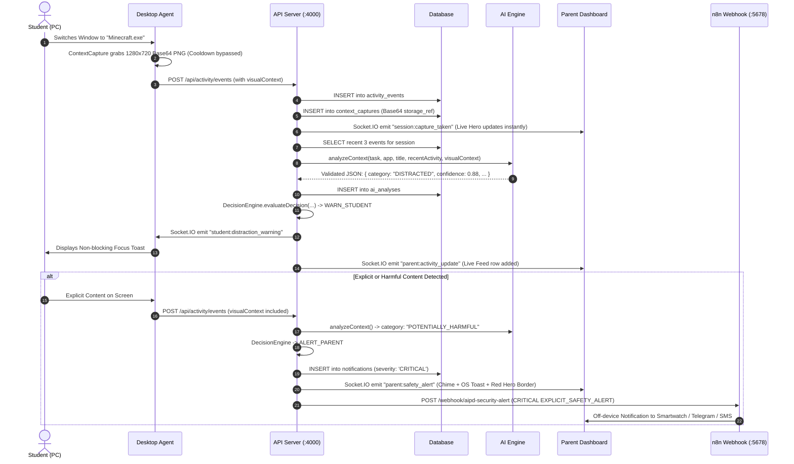
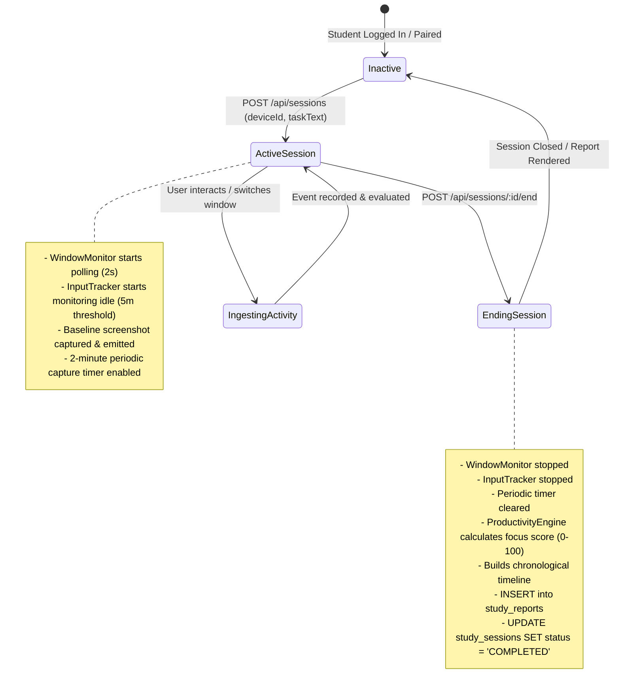
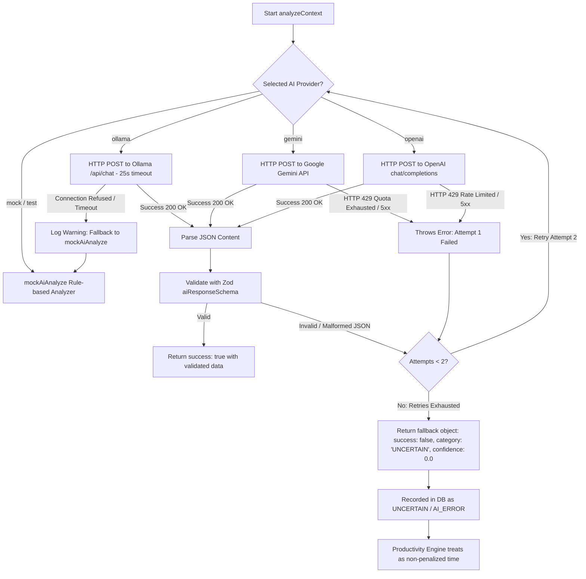
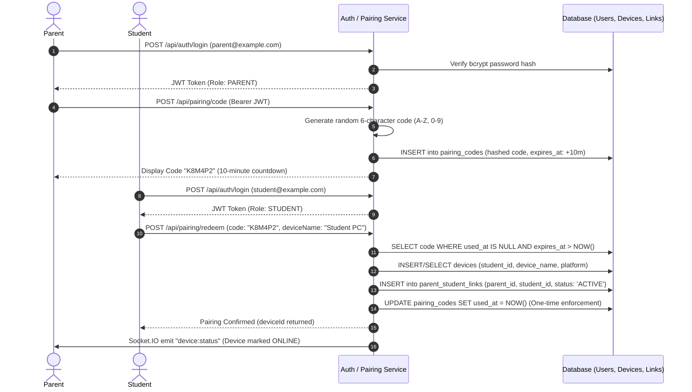
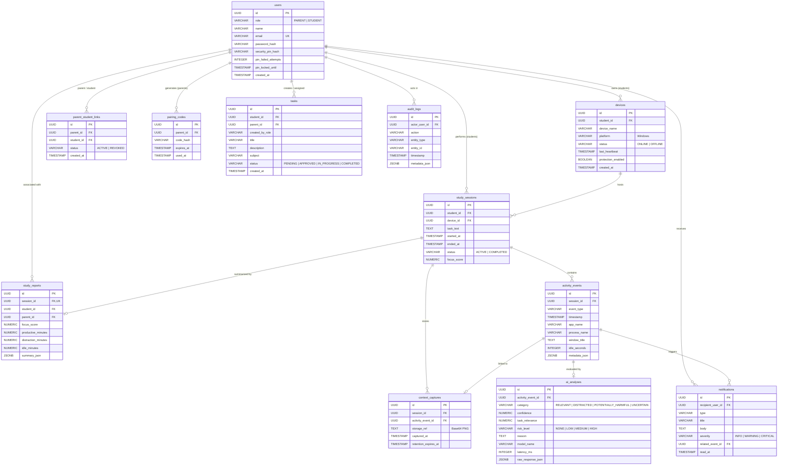

# Technical Architecture and Implementation Audit: AIPD — AI Study & Safety Coach

**Document Status**: Final Audit Report  
**Audit Mode**: Read-Only Source Code Analysis & Verification  
**Audited Target**: `d:\AIPD` Monorepo  
**Audit Date**: October 2026  
**Auditor**: Senior Systems & Security Architect  

---

## 1. Executive Summary

### 1.1 System Purpose & Scope
The **AI-Powered Digital Productivity & Safety Monitoring System (AIPD / StudySafe)** is a full-stack, multi-application platform designed to monitor student computer activity during active study sessions. It evaluates task alignment and digital safety using contextual artificial intelligence (multimodal vision-language models and deterministic rules), computes explainable productivity metrics, and provides real-time supervisor visibility with anti-tamper controls.

### 1.2 Target Users & Primary User Journeys
The platform targets two distinct user roles defined in [`packages/shared-types/index.js`](file:///d:/AIPD/packages/shared-types/index.js#L5-L8):

1. **Student (`STUDENT`)**:
   - Authenticates via password or 1-click demo (`student@example.com`).
   - Links their physical computer/device to a parent account via a 6-character, one-time pairing code.
   - Selects an approved task or inputs a study objective (e.g., *"Study Binary Trees in Java"*).
   - Enters an active study session where background window monitoring and aggregate input tracking activate.
   - Receives non-blocking distraction warnings when focus drifts.
   - Concludes sessions to view an objective study report with reconstructed timeline metrics.

2. **Parent / Supervisor (`PARENT`)**:
   - Authenticates via password or 1-click demo (`parent@example.com`).
   - Manages an executive security shield protected by a 4-digit Master PIN (`1234` default) with brute-force lockout defenses.
   - Generates temporary pairing codes for child device onboarding.
   - Observes active student sessions in real time via live WebSocket streams, including current active window, task relevance, and live high-definition desktop screen captures.
   - Toggles supervised protection policies per device (requiring master PIN verification).
   - Receives immediate multi-channel alerts (in-app toasts, audible chime, browser OS notifications, and external n8n webhooks) upon explicit content or tampering events.
   - Reviews historical session reports and assigns/approves tasks.

### 1.3 Application Modality
AIPD is a **hybrid dual-modality platform**:
- **Web Application**: The parent dashboard (`apps/parent-dashboard/`), marketing landing page (`apps/landing/`), and student browser fallback (`apps/student-desktop/src/`) run in any standard evergreen browser served from the unified Express backend on port `4000`.
- **Desktop Application**: An Electron desktop container (`apps/student-desktop/electron/`) designed for Windows environments, featuring operating-system-level active window detection (via Win32 user32 APIs through PowerShell C# reflection) and real screen capture via Electron's `desktopCapturer`.

### 1.4 State of the Project: Production-Ready MVP
AIPD is an **advanced, fully functioning Minimum Viable Product (MVP)**. It has transcended prototype status:
- All core HTTP REST endpoints and WebSocket channels are implemented and covered by an automated test suite (**55/55 tests passing: 50 backend, 5 desktop**).
- Dual database support is fully operational (embedded PGlite for zero-dependency local dev/testing and native PostgreSQL pool for production).
- An anti-tamper security PIN gate, automated brute-force lockout, and external n8n workflow integration are implemented and tested live.

### 1.5 Primary Incomplete & Risky Areas
1. **Synchronous In-Band AI Execution**: AI analysis is invoked synchronously inside the HTTP event ingestion request. Under LLM latency spikes or API rate limits, event ingestion can stall.
2. **Database Storage of Raw Base64 Screenshots**: Screen captures are saved directly as raw base64 data URLs in PostgreSQL `TEXT` columns (`context_captures.storage_ref`) rather than an object store (S3, MinIO, Google Cloud Storage).
3. **Absence of a Durable Background Task/AI Queue**: No Redis or BullMQ queue exists; if the server restarts during processing, in-flight analyses are lost.
4. **No Database Transaction Blocks**: Multi-table operations (such as session completion and report creation) do not wrap queries in `BEGIN ... COMMIT` transactions.

---

## 2. Repository Structure and Technology Stack

### 2.1 Workspace Directory Tree
The repository is structured as an npm workspaces monorepo:

```
d:\AIPD/
├── apps/
│   ├── landing/                  # Static HTML/CSS/JS presentation & product showcase
│   ├── parent-dashboard/         # Executive parent supervision SPA (Vanilla JS + Socket.IO + CSS)
│   └── student-desktop/          # Student workstation application
│       ├── electron/             # Electron main process, active window monitor, capture engine
│       ├── src/                  # Student renderer UI (HTML/CSS/JS)
│       └── tests/                # Electron component unit tests (node:test)
├── database/
│   ├── migrations/
│   │   ├── 001_initial_schema.sql      # Authoritative schema (11 relational tables)
│   │   └── 002_parent_security_pin.sql  # Parent Master PIN, attempts & lockout schema
│   └── seed/
│       └── seed.sql              # Deterministic demo accounts & linked relationships
├── docs/
│   └── n8n/
│       ├── aipd-parent-shield-workflow.json # n8n workflow definition
│       ├── import-workflow.js    # Programmatic n8n workflow import & activation script
│       └── README.md             # Automation guide
├── packages/
│   ├── config/                   # Centralized runtime configuration & env loading
│   ├── shared-types/             # Canonical constants, enums, and domain types
│   └── validation/               # Zod validation schemas for all inputs & AI outputs
├── services/
│   └── api/                      # Node.js + Express REST API & Socket.IO server (Port 4000)
│       ├── src/
│       │   ├── activity/         # Event ingestion, context capture storage, live feeds
│       │   ├── ai/               # Multi-provider adapter (Ollama, Gemini, OpenAI, Mock)
│       │   ├── auth/             # JWT, bcrypt, RBAC middleware, Master PIN service
│       │   ├── db/               # PostgreSQL pool & PGlite embedded client
│       │   ├── decision/         # Deterministic Decision Engine (Specification §9)
│       │   ├── devices/          # Heartbeat tracking, offline device sweeper, protection mode
│       │   ├── notifications/    # In-app notifications & external n8n webhook dispatcher
│       │   ├── pairing/          # 6-character pairing code generation & redemption
│       │   ├── productivity/     # Deterministic focus score engine & timeline reconstructor
│       │   ├── reports/          # Study report queries & retrieval
│       │   ├── sessions/         # Study session lifecycle management
│       │   ├── tasks/            # Student proposal & parent task assignment
│       │   ├── websocket/        # Socket.IO connection & room management
│       │   └── server.js         # HTTP server entrypoint & static route mounting
│       └── tests/                # 7 backend test suites (50 unit/integration tests)
├── .env                          # Local environment variables (gitignored)
├── .env.example                  # Environment configuration template
├── package.json                  # Root monorepo workspace manifest
└── README.md                     # Architecture specification & usage documentation
```

### 2.2 Technology Stack Summary

| Layer | Technologies / Libraries | Exact Version in Code | Purpose |
|---|---|---|---|
| **Runtime** | Node.js | v24+ compatible (ES Modules) | Server & local execution |
| **Backend API** | Express | `^4.21.0` | HTTP REST API routing |
| **Realtime** | Socket.IO / Client | `^4.7.5` | Bi-directional WebSocket events |
| **Desktop Shell** | Electron | `^32.1.0` | Secure student desktop container |
| **Database (Dev/Local)** | `@electric-sql/pglite` | `^0.2.14` | Embedded WASM PostgreSQL engine |
| **Database (Production)** | `pg` (node-postgres) | `^8.13.0` | Native connection pooling |
| **Authentication** | `jsonwebtoken`, `bcryptjs` | `^9.0.2`, `^2.4.3` | JWT tokens (HS256) & salted password hashing |
| **Validation** | `zod` | `^3.23.8` | Schema validation for API payloads & AI JSON |
| **Automation Engine** | n8n | `v2.44.7` (local on port 5678) | External webhook ingestion & multi-channel routing |
| **AI Providers** | Ollama, Gemini REST, OpenAI REST, Mock | Native `fetch` with AbortController | Multimodal context & safety classification |
| **Test Runner** | Node.js Built-in (`node:test`) | Node native | Concurrency=1 isolated test execution |

---

## 3. Architecture Diagrams

### A. System Architecture



---

### B. End-to-End Data Flow



---

### C. Study-Session Lifecycle



---

### D. AI Analysis and Quota/Failure Flow



---

### E. Authentication and Device Pairing Architecture



---

## 4. Complete Backend Audit

### 4.1 Exhaustive API Route Inventory

All routes are mounted in [`services/api/src/server.js`](file:///d:/AIPD/services/api/src/server.js#L60-L68):

| HTTP Method & Path | Purpose | Auth Required | Role / Ownership Check | Request Validation | Response Shape | Database Tables / External Services | Error Handling | Frontend Caller | Implementation Status & Test Evidence |
|---|---|---|---|---|---|---|---|---|---|
| `POST /api/auth/register` | User account registration | No | None | `registerSchema`: email, password (min 6), name, role (`PARENT` \| `STUDENT`) | `{ user: { id, name, email, role }, token }` | `users` | 400 on Zod failure, 409 duplicate email, 500 server error | `apps/parent-dashboard/app.js`, `apps/student-desktop/src/app.js` | **IMPLEMENTED**<br>Covered in `auth.test.js` |
| `POST /api/auth/login` | User authentication | No | None | `loginSchema`: email (string), password (string) | `{ user: { id, name, email, role }, token }` | `users` | 400 on Zod failure, 401 invalid credentials, 500 server error | Both frontends login views | **IMPLEMENTED**<br>Covered in `auth.test.js` |
| `GET /api/auth/me` | Current session verification | Yes (JWT) | Authenticated user | None | `{ user: { id, role, name, email } }` | `users` (via token payload) | 401 unauthorized | Both frontends session restoration | **IMPLEMENTED**<br>Covered in `auth.test.js` |
| `GET /api/auth/pin/status` | Read master PIN setup & lockout status | Yes (JWT) | `PARENT` role required | None | `{ isConfigured, isLocked, lockedUntil, remainingAttempts, autoLockMinutes }` | `users` | 401 unauthorized, 403 role forbidden | `apps/parent-dashboard/app.js` | **IMPLEMENTED**<br>Covered in `security-pin.test.js` |
| `POST /api/auth/pin/verify` | Authorize session or sensitive toggle | Yes (JWT) | `PARENT` role required | `verifyPinSchema`: 4-6 digit numeric string | `{ success: true, authorized: true, expiresAt }` | `users`, `audit_logs`, n8n webhook on lockout | 400 validation, 401 wrong PIN (returns `remainingAttempts`), 423 lockout active | `apps/parent-dashboard/app.js` | **IMPLEMENTED**<br>Covered in `security-pin.test.js` |
| `POST /api/auth/pin/set` | Set or update 4-digit Master PIN | Yes (JWT) | `PARENT` role required | `setPinSchema`: pin, optional currentPin | `{ success: true, message: "Security PIN updated" }` | `users`, `audit_logs`, n8n webhook | 400 validation, 401 incorrect current PIN | `apps/parent-dashboard/app.js` | **IMPLEMENTED**<br>Covered in `security-pin.test.js` |
| `POST /api/pairing/code` | Generate short-lived pairing code | Yes (JWT) | `PARENT` role required | None | `{ code, expiresAt, expiresInSeconds }` | `pairing_codes` | 401 unauthorized, 403 role forbidden, 500 server error | `apps/parent-dashboard/app.js` | **IMPLEMENTED**<br>Covered in `pairing.test.js` |
| `POST /api/pairing/redeem` | Link student PC using pairing code | Yes (JWT) | `STUDENT` role required | `redeemPairingCodeSchema`: code, deviceName, platform | `{ success: true, deviceId, device }` | `pairing_codes`, `devices`, `parent_student_links` | 400 validation / expired / already used code | `apps/student-desktop/src/app.js`, `main.js` | **IMPLEMENTED**<br>Covered in `pairing.test.js` |
| `GET /api/devices` | List authorized devices | Yes (JWT) | Parents see linked child devices; students see own | None | `{ devices: [...] }` | `devices`, `users`, `parent_student_links` | 401 unauthorized, 500 server error | Both frontends device lists | **IMPLEMENTED**<br>Covered in `e2e-session-flow.test.js` |
| `GET /api/devices/parent-link-status` | Verify if student has active parent link | Yes (JWT) | Authenticated student | None | `{ isLinked: boolean }` | `parent_student_links` | 500 server error | `apps/student-desktop/src/app.js` | **IMPLEMENTED** |
| `GET /api/devices/:id/status` | Get device status & heartbeat | Yes (JWT) | Ownership/link verified | UUID param | `{ id, device_name, status, last_heartbeat, protection_enabled, student_name }` | `devices`, `parent_student_links` | 404 device not found / unauthorized | Both frontends | **IMPLEMENTED** |
| `POST /api/devices/:id/heartbeat` | Keepalive signal from child agent | Yes (JWT) | `STUDENT` (must own device) | UUID param | `{ success: true, status: 'ONLINE', timestamp }` | `devices`, Socket.IO `device:status` | 403 ownership mismatch, 404 not found | Electron `main.js` (every 30s) | **IMPLEMENTED**<br>Covered in `e2e-session-flow.test.js` |
| `PATCH /api/devices/:id/protection` | Toggle supervised protection mode | Yes (JWT) | `PARENT` (must be linked to student) | `updateProtectionSchema`: protectionEnabled, optional pin | `{ success: true, deviceId, protectionEnabled }` | `devices`, `audit_logs`, n8n webhook, Socket.IO | 401 wrong PIN, 423 locked, 403 forbidden | `apps/parent-dashboard/app.js` | **IMPLEMENTED**<br>Covered in `security-pin.test.js` |
| `GET /api/sessions` | List historical and active sessions | Yes (JWT) | Scoped to parent's children or student | None | `{ sessions: [...] }` | `study_sessions`, `devices`, `parent_student_links` | 500 server error | Both frontends session views | **IMPLEMENTED** |
| `POST /api/sessions` | Start a new study session | Yes (JWT) | `STUDENT` (owns device & linked to parent) | `createSessionSchema`: deviceId, taskText (min 3) | `{ id, student_id, device_id, task_text, status: 'ACTIVE', started_at }` | `study_sessions`, `devices`, `parent_student_links`, Socket.IO | 400 validation, 403 device ownership or unlinked student | Both student desktop and web app | **IMPLEMENTED**<br>Covered in `e2e-session-flow.test.js` |
| `GET /api/sessions/active-for-parent` | Real-time active session hero data | Yes (JWT) | `PARENT` role required | None | `{ activeSession: { id, student_name, device_name, task_text, started_at, protection_enabled, latest_screenshot, latest_screenshot_time } }` | `study_sessions`, `devices`, `context_captures`, `parent_student_links` | 500 server error | `apps/parent-dashboard/app.js` | **IMPLEMENTED**<br>Covered in `e2e-session-flow.test.js` |
| `GET /api/sessions/:id/captures` | Retrieve session screenshot captures | Yes (JWT) | Scoped to linked parent or owner student | UUID param | `{ captures: [...] }` | `context_captures`, `study_sessions`, `parent_student_links` | 403 unauthorized, 404 not found | Parent Captures Gallery | **IMPLEMENTED** |
| `GET /api/sessions/:id` | Session detail & metrics breakdown | Yes (JWT) | Scoped to parent or student | UUID param | `{ session, metrics, eventsCount }` | `study_sessions`, `activity_events`, `ai_analyses` | 404 session not found | Both frontends | **IMPLEMENTED** |
| `POST /api/sessions/:id/end` | End study session & generate report | Yes (JWT) | `STUDENT` role required (must own session) | UUID param | Full study report object with `focus_score`, `timeline`, `recommendations` | `study_sessions`, `activity_events`, `ai_analyses`, `study_reports`, Socket.IO | 400 session already completed, 403 forbidden | Both student desktop and web app | **IMPLEMENTED**<br>Covered in `e2e-session-flow.test.js` |
| `POST /api/activity/events` | Ingest real-time window/input event | Yes (JWT) | `STUDENT` (must own session) | `activityEventSchema`: sessionId, eventType, timestamp, appName, windowTitle, idleSeconds, visualContext | `{ eventId, decision, aiCategory, hasScreenshot }` | `activity_events`, `context_captures`, `ai_analyses`, `notifications`, Socket.IO, n8n webhook | 400 validation, 403 forbidden, 404 session | Desktop WindowMonitor & TabListener | **IMPLEMENTED**<br>Covered in `e2e-session-flow.test.js` |
| `POST /api/activity/events/batch` | Ingest queued offline events | Yes (JWT) | `STUDENT` | `batchActivityEventsSchema`: array of events (max 500) | `{ count, results: [...] }` | `activity_events`, `context_captures` | 400 validation error | Desktop `flushOfflineQueue` | **IMPLEMENTED** |
| `POST /api/ai/analyze` | Direct AI contextual evaluation | Yes (JWT) | Authenticated user | `{ task, appName, processName, windowTitle, idleSeconds, visualContext, recentActivity }` | `{ success, data: { category, confidence, reason, taskRelevance, riskLevel }, latencyMs, model }` | None (Calls configured AI engine) | 400 missing task, 500 AI execution failure | Testing / On-demand evaluation | **IMPLEMENTED**<br>Covered in `ai-adapter.test.js` |
| `GET /api/reports` | List study reports | Yes (JWT) | Scoped to parent's children or student | None | `{ reports: [...] }` | `study_reports`, `study_sessions`, `users`, `parent_student_links` | 500 server error | Both frontends Reports tab | **IMPLEMENTED** |
| `GET /api/reports/:id` | Retrieve detailed study report | Yes (JWT) | Scoped to authorized parent or student | UUID param | Full report record including `summary_json` | `study_reports`, `study_sessions`, `users`, `parent_student_links` | 404 report not found or unauthorized | Reports viewer modal | **IMPLEMENTED** |
| `GET /api/notifications` | List user notification history | Yes (JWT) | Authenticated user | None | `{ notifications: [...] }` | `notifications` | 500 server error | Parent Notification Center | **IMPLEMENTED** |
| `POST /api/notifications/:id/read` | Mark notification as read | Yes (JWT) | Authenticated recipient | UUID param | `{ success: true, notification }` | `notifications` | 404 notification not found | Parent Notification Center | **IMPLEMENTED** |
| `GET /api/tasks` | List study tasks | Yes (JWT) | Scoped to parent or student | None | `{ tasks: [...] }` | `tasks` | 500 server error | Both frontends Task lists | **IMPLEMENTED** |
| `POST /api/tasks` | Create / Propose a study task | Yes (JWT) | Authenticated user | `{ title, description, subject, studentId }` | `{ task: { id, title, description, subject, status, ... } }` | `tasks`, Socket.IO (`task:proposed`) | 400 validation, 500 server error | Both frontends Task creation | **IMPLEMENTED** |
| `PATCH /api/tasks/:id/status` | Update task status (APPROVED, etc.) | Yes (JWT) | Parent approves, Student completes | `{ status }` | `{ task }` | `tasks`, Socket.IO (`task:status_changed`) | 400 missing status, 404 not found | Both frontends Task management | **IMPLEMENTED** |

---

### 4.2 Data Relationships and Integrity Rules
1. **User Role Enforcement**: Strictly validated via `CHECK (role IN ('PARENT', 'STUDENT'))`. Passwords hashed with `bcryptjs` (cost factor 10).
2. **Device Ownership**: Each physical machine in `devices` references `student_id` (foreign key to `users(id)`).
3. **Supervisor Links**: The `parent_student_links` table enforces active pairing. Unlinked students cannot start study sessions; unlinked parents cannot view devices, captures, or reports.
4. **Session Boundaries**: Sessions are bound to both a `student_id` and a `device_id`. Status is constrained by `CHECK (status IN ('PENDING', 'ACTIVE', 'PAUSED', 'COMPLETED', 'CANCELLED'))`.
5. **Context Captures**: `context_captures` references `session_id` and optionally `activity_event_id`. The `retention_expires_at` column is calculated at insertion (`NOW() + 7 days`).

### 4.3 Database Migration Engine
Migrations are managed in [`database/migrations/`](file:///d:/AIPD/database/migrations):
- Execution is handled programmatically by `initDb()` in [`services/api/src/db/index.js`](file:///d:/AIPD/services/api/src/db/index.js#L72-L90).
- `initDb()` dynamically reads the `database/migrations/` directory, filters for `.sql` files, sorts them alphanumerically, and executes them against the active client (`PGlite.exec(sql)` or `pg.Pool.query(sql)`).
- Migration `001_initial_schema.sql` establishes the 11 baseline tables.
- Migration `002_parent_security_pin.sql` non-destructively adds `security_pin_hash`, `pin_failed_attempts`, and `pin_locked_until` columns to `users`.

### 4.4 Background Processes & Daemons
Two background intervals are maintained by the server:
1. **Offline Device Sweeper**: Defined in [`services/api/src/devices/deviceService.js:188`](file:///d:/AIPD/services/api/src/devices/deviceService.js#L188-L215). Runs every 30 seconds via `setInterval` in `server.js`. Flags any `ONLINE` device as `OFFLINE` if `NOW() - last_heartbeat > 90,000ms`, emitting real-time `device:status` events to linked parents.
2. **Decision Engine Cache Cleaner**: Defined in [`services/api/src/decision/decisionEngine.js:12`](file:///d:/AIPD/services/api/src/decision/decisionEngine.js#L12-L19). Runs every 60 seconds to prune deduplication cache keys older than 120 seconds.

---

## 5. Complete AI Integration Audit

### 5.1 AI Call-Site Inventory

| Source File & Line | Calling Function | AI Task / Purpose | Provider & Model Used | Inputs Sent to Model | Screen Image Sent? | Output Handling & Validation | Storage Destination | Failure Behavior |
|---|---|---|---|---|---|---|---|---|
| [`services/api/src/activity/activityService.js:127`](file:///d:/AIPD/services/api/src/activity/activityService.js#L127) | `processActivityEvent()` | Classify foreground activity against task (Relevance, Distraction, Harm) | Configured in `AI_PROVIDER`: `ollama` (`llama3.2:latest`), `gemini` (`gemini-1.5-flash`), `openai` (`gpt-4o-mini`), or `mock` | `task`, `appName`, `processName`, `windowTitle`, `idleSeconds`, `recentActivity` (last 3 events), `visualContext` | **YES** (if event has `visualContext`) | Parsed via `JSON.parse()`, validated against Zod `aiResponseSchema` | Inserted into `ai_analyses` table; evaluated by Decision Engine | Catches error; 1x retry; returns fallback `{ success: false, category: 'UNCERTAIN' }` |
| [`services/api/src/ai/aiRoutes.js:18`](file:///d:/AIPD/services/api/src/ai/aiRoutes.js#L18) | `POST /api/ai/analyze` | On-demand or direct API evaluation of activity context | Same as above | `task`, `appName`, `processName`, `windowTitle`, `idleSeconds`, `recentActivity`, `visualContext` | **YES** (if included in body) | Same as above | Returned directly to HTTP caller as JSON | Catches error; returns HTTP 500 with error message |

### 5.2 Model Details & Providers

1. **Ollama (Default in `.env`)**:
   - Model: `llama3.2:latest` (configurable via `OLLAMA_MODEL`).
   - Endpoint: `http://localhost:11434/api/chat`.
   - Timeout: 25 seconds via `AbortController`.
   - Format: `format: 'json'`, `temperature: 0.1`.
   - Resilience: If Ollama connection fails or times out, `aiAdapter.js:283` logs a warning and **automatically falls back to the deterministic rule analyzer `mockAiAnalyze`**.

2. **Google Gemini**:
   - Model: `gemini-1.5-flash` (configurable via `GEMINI_MODEL`).
   - Endpoint: `https://generativelanguage.googleapis.com/v1beta/models/{model}:generateContent`.
   - Auth: API key passed as query parameter `?key={GEMINI_API_KEY}`.
   - Format: `responseMimeType: 'application/json'`, `temperature: 0.1`.
   - Vision Payload: Base64 data URLs are split into mime type and base64 payload, transmitted via `inlineData`.

3. **OpenAI**:
   - Model: `gpt-4o-mini` (configurable via `OPENAI_MODEL`).
   - Endpoint: `https://api.openai.com/v1/chat/completions`.
   - Auth: HTTP Header `Authorization: Bearer {OPENAI_API_KEY}`.
   - Format: `response_format: { type: 'json_object' }`, `temperature: 0.1`.
   - Vision Payload: Transmitted via `image_url: { url: context.visualContext }`.

4. **Deterministic Rule Engine (`mockAiAnalyze`)**:
   - Executes instantaneously in pure Node.js (0ms network latency).
   - Used in test runs (`NODE_ENV === 'test'`) and as automatic fallback when external models are unreachable.
   - Comprehensive safety heuristic: Scans active window titles, process names, and tasks for explicit keywords (`self-harm`, `suicide`, `bomb`, `explicit`, `porn`, `xxx`, `nsfw`, `adult content`, `nudity`, `erotic`, `casino`, `gambling`).
   - Relevance heuristic: Analyzes keyword intersections between assigned tasks and active window titles, recognizing coding IDEs and research tools.

### 5.3 Prompt Template and Schema Validation

The system uses a unified system prompt ([`services/api/src/ai/aiAdapter.js:8-29`](file:///d:/AIPD/services/api/src/ai/aiAdapter.js#L8-L29)) instructing the model to judge relevance strictly against the assigned task and output valid JSON conforming to:

```json
{
  "category": "RELEVANT" | "DISTRACTED" | "POTENTIALLY_HARMFUL",
  "confidence": 0.0 to 1.0,
  "reason": "short factual explanation",
  "taskRelevance": 0.0 to 1.0,
  "riskLevel": "NONE" | "LOW" | "MEDIUM" | "HIGH",
  "suggestedStudentMessage": "string or empty",
  "requiresParentAlert": boolean
}
```

Validation is performed strictly via Zod `aiResponseSchema.parse(rawResult)` in [`packages/validation/index.js:7-24`](file:///d:/AIPD/packages/validation/index.js#L7-L24). If the output deviates from schema constraints (e.g., confidence out of range 0-1, unknown enum category, missing reason), Zod throws a validation error, triggering the retry loop.

---

## 6. API Usage, Free Tiers, Quotas, and Cost Controls

### 6.1 Failure & Quota Handling Matrix

| Failure Scenario | Current Behavior in Code | Source Evidence | Missing Handling | Recommended Fix |
|---|---|---|---|---|
| **HTTP 429 (Rate Limit / Quota Exhausted)** | Throws `Error('... API error 429: ...')`. Triggers immediate attempt 2. If attempt 2 also 429s, returns `{ success: false, category: 'UNCERTAIN' }`. | [`aiAdapter.js:146, 194, 307`](file:///d:/AIPD/services/api/src/ai/aiAdapter.js#L146) | No exponential backoff; no detection of `Retry-After` header; burns retry immediately. | Implement exponential backoff with jitter (e.g. 1s, 3s) and inspect `Retry-After`. Fallback immediately to deterministic rule engine upon 429. |
| **Request Timeout** | Ollama aborts after 25s via `AbortController`. Gemini and OpenAI rely on standard fetch timeout (indefinite or Node default). | [`aiAdapter.js:221`](file:///d:/AIPD/services/api/src/ai/aiAdapter.js#L221) | Gemini and OpenAI fetch calls do not attach an `AbortSignal`. A hung network socket could hold Express request workers open. | Wrap all external provider calls in an `AbortSignal.timeout(10000)` (10s cap). |
| **Malformed JSON from LLM** | `JSON.parse()` throws SyntaxError; loop catches error and retries once (attempt 2). If attempt 2 fails, returns `UNCERTAIN`. | [`aiAdapter.js:274-322`](file:///d:/AIPD/services/api/src/ai/aiAdapter.js#L274) | No regex JSON extraction (`/\{[\s\S]*\}/`) to repair models that output conversational markdown fences (` ```json `). | Add a JSON substring extractor before `JSON.parse()` to strip leading/trailing conversational text. |
| **Model Unavailable / Offline** | Ollama errors are caught at `aiAdapter.js:282`; silently falls back to `mockAiAnalyze`. Session continues without failure. | [`aiAdapter.js:282-285`](file:///d:/AIPD/services/api/src/ai/aiAdapter.js#L282) | Gemini and OpenAI do not have the same immediate silent fallback to `mockAiAnalyze` before burning retries. | Unify provider fallback so that any provider network failure immediately routes through `mockAiAnalyze`. |
| **Application / Server Restart** | In-flight event ingestion requests are aborted. Since there is no durable message queue, interrupted events are lost. | [`apps/student-desktop/electron/main.js:18`](file:///d:/AIPD/apps/student-desktop/electron/main.js#L18) | In-memory `offlineQueue` on Electron desktop is cleared on app termination. Un-synced events are not persisted to SQLite/disk. | Persist desktop `offlineQueue` to local disk (e.g. `electron-store` or SQLite). |
| **Missing AI Results in Final Report** | `buildSessionSummary()` maps events to analyses. If an event has no analysis or analysis is `UNCERTAIN` / `AI_ERROR`, it is **not penalized**. | [`productivityEngine.js:118-158`](file:///d:/AIPD/services/api/src/productivity/productivityEngine.js#L118) | None (this is resilient by design: unclassified time defaults to non-distraction). | Existing behavior is fair to student; maintain this architecture. |

### 6.2 Existing Cost Controls & Sampling Mitigations
1. **Sampling Interval & Debounce**:
   - Window switch captures are event-driven.
   - Periodic baseline captures occur every 2 minutes (`config.periodicCaptureIntervalMs = 120000`), rather than streaming video.
2. **Alert Deduplication Cache**:
   - `decisionEngine.js:89` implements a 60-second in-memory cooldown per `harmful:{sessionId}:{appName}` and `distraction:{sessionId}:{appName}` to prevent spamming notifications for identical foreground states.
3. **No Automatic Multi-Provider Failover**:
   - `config.aiProvider` is static per environment run. There is no automatic runtime rotation between Gemini and OpenAI if one provider's monthly credit exhausts.

---

## 7. Screenshot and Desktop Monitoring Audit

### 7.1 Desktop Agent Architecture
- **Framework**: Electron (`apps/student-desktop/electron/`).
- **Operating System Integration**:
  - Foreground window title and application process name are detected in [`active-window-monitor.js:80-100`](file:///d:/AIPD/apps/student-desktop/electron/active-window-monitor.js#L80) using a compiled in-memory C# P/Invoke script via PowerShell that calls `GetForegroundWindow()`, `GetWindowText()`, and `GetWindowThreadProcessId()`.
  - Polling interval: 2,000ms.
- **Privacy Protections**:
  - **Zero Keylogging**: [`input-tracker.js`](file:///d:/AIPD/apps/student-desktop/electron/input-tracker.js) tracks only aggregate interactions (`interactionCount++`) and computes idle duration. Keystrokes, clipboard buffers, and text contents are never read, buffered, or stored.
  - **No Continuous Video**: Desktop captures are strictly event-triggered (window switch) or periodic snapshots (2 minutes).

### 7.2 Screenshot Capture & Transmission Pipeline
1. **Capture Trigger**:
   - Triggered on active window focus change (`WINDOW_SWITCH`) or 2-minute timer (`PERIODIC_2MIN`).
   - Electron's `desktopCapturer.getSources({ types: ['screen'], thumbnailSize: { width: 1280, height: 720 } })` grabs the screen buffer and converts it to a PNG data URL (`data:image/png;base64,...`).
2. **Ingestion & Storage**:
   - Dispatched via HTTP POST to `/api/activity/events` with field `visualContext`.
   - The API server immediately inserts the capture into `context_captures` table with a 7-day retention expiration (`retention_expires_at = NOW() + 7 days`).
   - Pushed via Socket.IO `session:capture_taken` directly to the parent dashboard, updating the Live Hero Monitor in real time.
3. **Security Boundaries**:
   - Electron `BrowserWindow` runs with `contextIsolation: true`, `nodeIntegration: false`, and `sandbox: true`.
   - IPC communication between renderer and main process is strictly mediated by [`preload.js`](file:///d:/AIPD/apps/student-desktop/electron/preload.js) via an explicit method allowlist.
   - Monitoring starts **only** when an authorized study session starts (`session:start`) and stops immediately when the session ends (`session:end`). Monitoring cannot run outside an active study session.

---

## 8. Database and Data Retention

### 8.1 Entity Relationship Diagram



### 8.2 Database Schema Insights & Deficiencies
1. **Multiple AI Analyses Per Session**: Fully supported. `ai_analyses` links 1:1 to `activity_events`, and each session contains arbitrary numbers of activity events.
2. **Storage of Raw Base64**: `context_captures.storage_ref` stores base64 PNG data URLs directly in the database. While convenient for embedded development, a single 1280x720 base64 frame is ~300KB to 700KB. A 2-hour study session with 60 captures generates ~30MB of database bloat per session.
3. **Retention Policy**: `context_captures.retention_expires_at` is populated at creation (`NOW() + 7 days`), but **no automated database cleanup cron/worker currently executes `DELETE FROM context_captures WHERE retention_expires_at < NOW()`**. Expired captures currently accumulate indefinitely unless pruned manually.

---

## 9. Frontend and User Journeys

### 9.1 Frontend Route & API Integration Map

| Application & View | Frontend File | Triggering Element | API Endpoint Invoked | Method | Payload / Headers | UI State / Feedback Rendered |
|---|---|---|---|---|---|---|
| **Parent Login** | `apps/parent-dashboard/app.js` | Form Submit (`#auth-form`) | `/api/auth/login` | `POST` | `{ email, password }` | Stores JWT in `localStorage('parent_token')`; transitions to `#dashboard-view` |
| **Parent Demo Login** | `apps/parent-dashboard/app.js` | 1-Click Demo Button (`#demo-parent-btn`) | `/api/auth/login` | `POST` | Demo parent credentials | Instant bypass to dashboard with demo data |
| **Parent Security PIN Verify** | `apps/parent-dashboard/app.js` | PIN Numpad Submit (`#parent-security-modal`) | `/api/auth/pin/verify` | `POST` | `{ pin }` | Unlocks controls for 5m; updates `#tamper-guard-pill` to unlocked green; closes modal |
| **Parent Security PIN Set** | `apps/parent-dashboard/app.js` | Manage PIN Form (`#set-pin-form`) | `/api/auth/pin/set` | `POST` | `{ pin, currentPin }` | Shows success feedback; updates PIN status |
| **Parent Protection Toggle** | `apps/parent-dashboard/app.js` | Toggle Switch on Device Card | `/api/devices/:id/protection` | `PATCH` | `{ protectionEnabled, pin }` | Prompts PIN modal if locked; updates toggle; emits toast |
| **Parent Pairing Code** | `apps/parent-dashboard/app.js` | Button (`#generate-code-btn`) | `/api/pairing/code` | `POST` | Bearer JWT | Displays 6-character code in `#pairing-code-text` with active 10m countdown |
| **Parent Live Monitor** | `apps/parent-dashboard/app.js` | Page Load / WebSocket Event | `/api/sessions/active-for-parent` | `GET` | Bearer JWT | Populates `#live-task-hero`, latest screenshot, app pill, and active student name |
| **Student Login** | `apps/student-desktop/src/app.js` | Form Submit (`#auth-form`) | `/api/auth/login` | `POST` | `{ email, password }` | Stores token; checks parent link status; transitions to Task or Pairing view |
| **Student Pairing** | `apps/student-desktop/src/app.js` | Form Submit (`#pairing-form`) | `/api/pairing/redeem` | `POST` | `{ code, deviceName, platform }` | On success, transitions to `#task-section` |
| **Student Start Session** | `apps/student-desktop/src/app.js` | Button (`#start-session-btn`) | `/api/sessions` | `POST` | `{ deviceId, taskText }` | Starts session; activates timer; starts WindowMonitor & InputTracker in Electron |
| **Student End Session** | `apps/student-desktop/src/app.js` | Button (`#end-session-btn`) | `/api/sessions/:id/end` | `POST` | Bearer JWT | Stops monitor; displays verified focus score, timeline, and recommendations in `#report-section` |

---

## 10. Testing and Reliability

### 10.1 Automated Test Execution Summary
The repository includes a comprehensive automated test suite built on Node's native test runner (`node:test`). Execution is verified with **zero test failures**:

```
> npm test

> @aipd/api@1.0.0 test
> node --test --test-concurrency=1 tests/*.test.js

✔ AI Adapter Tests (6 tests)
✔ Auth Service Tests (5 tests)
✔ Decision Engine Tests (8 tests)
✔ End-to-End Study & Safety Coach Lifecycle Flow (8 tests)
✔ Pairing Service Tests (5 tests)
✔ Productivity Engine Tests (5 tests)
✔ Parent Security PIN & Tamper Shield Tests (6 tests)

ℹ tests 50 | pass 50 | fail 0 | cancelled 0

> @aipd/student-desktop@1.0.0 test
> node --test tests/*.test.js

✔ Student Desktop Monitoring & Privacy Tests (4 tests)

ℹ tests 5 | pass 5 | fail 0 | cancelled 0

Total Verified Tests: 55 Passing / 0 Failing
```

### 10.2 Test Isolation & Mocking Strategy
- **Database**: When `process.env.NODE_ENV === 'test'`, [`db/index.js:37`](file:///d:/AIPD/services/api/src/db/index.js#L37) provisions a fresh, transient in-memory PGlite instance. Tests never touch or pollute local development storage (`.pglite-data`).
- **AI Provider**: Tests run under `config.aiProvider = 'mock'`, routing requests through deterministic heuristic classification (`mockAiAnalyze`) with 0ms network latency and zero external API costs.
- **Desktop Hardware**: `ActiveWindowMonitor` supports `{ mockMode: true }` allowing simulated window transitions (`simulateWindowChange()`) without requiring live Windows user32 OS handles.

---

## 11. Security, Privacy, and Operational Risks

The codebase was audited for security vulnerabilities, privacy leaks, and stability risks, ranked by severity:

### 1. HIGH: Synchronous AI Blocking in Event Pipeline
- **Finding**: Inside [`services/api/src/activity/activityService.js:127`](file:///d:/AIPD/services/api/src/activity/activityService.js#L127), every window focus change event awaits `analyzeContext()` synchronously.
- **Risk**: If the external AI provider (Gemini/OpenAI) experiences high latency (5-15 seconds), the Express worker is blocked. The student desktop client's HTTP request hangs, delaying subsequent window events.
- **Evidence**: `aiResult = await analyzeContext(contextPayload);` called directly before sending HTTP 201 response.

### 2. MEDIUM: Base64 Screenshot Storage in Relational Database
- **Finding**: Screen captures are inserted directly as base64 PNG data strings into the `context_captures` PostgreSQL table.
- **Risk**: Database size grows rapidly (~30MB per 2-hour session). Querying `study_sessions` with capture joins can consume high RAM and network bandwidth.
- **Evidence**: [`services/api/src/activity/activityService.js:70-72`](file:///d:/AIPD/services/api/src/activity/activityService.js#L70): `INSERT INTO context_captures (... storage_ref ...) VALUES ($1, ..., $4)`.

### 3. MEDIUM: Lack of Multi-Statement Database Transactions
- **Finding**: Multi-step business logic (e.g. `endSession` updating session status, computing metrics, and creating reports) executes multiple independent `query()` calls without `BEGIN ... COMMIT`.
- **Risk**: If the server crashes or database connection drops between session completion and report insertion, a session can become marked `COMPLETED` without an accompanying report record.
- **Evidence**: [`services/api/src/sessions/sessionService.js:105-180`](file:///d:/AIPD/services/api/src/sessions/sessionService.js#L105).

### 4. LOW: Absence of Automated Capture Pruning Worker
- **Finding**: `retention_expires_at` is populated at insertion, but no automated SQL sweeper deletes expired records.
- **Risk**: Disk storage will fill over months of usage.
- **Evidence**: No `DELETE FROM context_captures WHERE retention_expires_at < NOW()` exists in `server.js` or `deviceService.js`.

### 5. VERIFIED SAFE: Keylogging & Privacy Boundaries
- **Finding**: Verified that `inputTracker.js` stores zero keystrokes or text buffers. Electron `preload.js` strictly isolates Node capabilities with `contextIsolation: true`. Visual monitoring only operates during explicitly started study sessions.

---

## 12. Implementation Gap Analysis

| Feature Area | Current Status | Code Support & Evidence | Implementation Gap / Next Step |
|---|---|---|---|
| **JWT Authentication & RBAC** | **Implemented** | `authRoutes.js`, `authService.js`, `authMiddleware.js` | Production deployment needs refresh tokens; currently uses 7-day access token. |
| **Parent Master Security PIN** | **Implemented** | `pinService.js`, `002_parent_security_pin.sql`, `#parent-security-modal` | Fully functional with 5-attempt brute-force lockout and auto-lock countdown. |
| **Device Pairing** | **Implemented** | `pairingService.js`, `pairingRoutes.js`, 6-char hash | One-time use and 10-minute expiry enforced. |
| **Session Lifecycle** | **Implemented** | `sessionService.js`, `sessionRoutes.js`, WebSockets | Full start, pause, resume, and completion lifecycle operational. |
| **Foreground Window Detection** | **Implemented** | `active-window-monitor.js` via PowerShell P/Invoke | Works on Windows; non-Windows environments fallback to mock mode. |
| **Screen Context Capture** | **Implemented** | `context-capture.js`, Electron `desktopCapturer` | Bypasses cooldown on window switches; captures 1280x720 base64 screenshots. |
| **AI Contextual Analysis** | **Implemented** | `aiAdapter.js` (Ollama, Gemini, OpenAI, Mock) | Fully functional; fallback to deterministic rules on Ollama timeout. |
| **Deterministic Decision Engine**| **Implemented** | `decisionEngine.js`, Specification §9 | Correctly evaluates thresholds and deduplicates alerts. |
| **Focus Score Engine** | **Implemented** | `productivityEngine.js`, Specification §13.2 | Transparent, explainable formula clamping score between 0 and 100. |
| **Off-Device n8n Automation** | **Implemented** | `webhookService.js`, `aipd-parent-shield-workflow.json` | Webhook live on port 5678; dispatches tamper & safety alerts. |
| **Durable AI Job Queue** | **Planned / Absent**| In-memory synchronous execution only | No BullMQ or Redis queue; AI executes directly in HTTP request thread. |
| **Object Store for Images** | **Planned / Absent**| `storage_ref` stores base64 text in PostgreSQL | S3/MinIO driver not yet implemented; images stored in DB. |
| **Automated Data Pruning** | **Partially Implemented**| `retention_expires_at` column populated | Background cleanup worker to delete expired rows is not yet implemented. |

---

## 13. Recommended Next Steps

### 13.1 Top 5 Priority Recommendations

1. **Decouple AI Analysis from HTTP Event Ingestion (Asynchronous Queue)**:
   - Convert `processActivityEvent()` into a 2-stage pipeline: store the event immediately, acknowledge the client with HTTP 201, and push the analysis job to an asynchronous queue.
   - Prevents student desktop hangs when external LLM APIs experience latency.

2. **Migrate Screenshot Storage to Disk or Object Store**:
   - Replace direct base64 database string storage with a local file storage directory (`/uploads/captures/{sessionId}/{captureId}.png`) or an S3-compatible bucket (MinIO/AWS S3). Store only the relative file path or signed URL in `context_captures.storage_ref`.

3. **Wrap Multi-Entity Writes in Database Transactions**:
   - Add a transaction helper (`withTransaction(async (client) => { ... })`) to `services/api/src/db/index.js` and wrap `endSession()` and `redeemPairingCode()` to prevent partial state corruption.

4. **Implement Automated Retention Cleanup Cron**:
   - Add a daily sweeping task in `services/api/src/server.js` executing:
     ```sql
     DELETE FROM context_captures WHERE retention_expires_at < NOW();
     ```

5. **Enhance LLM Quota Backoff & Provider Circuit Breaking**:
   - Add exponential backoff on HTTP 429 errors.
   - Implement an automated circuit breaker: if Gemini returns 429 quota exhaustion, route traffic to OpenAI or the deterministic rule engine for 15 minutes before retrying.

---

## 14. Inspected Files Inventory

Every finding in this audit was established through direct inspection of the following repository files:

### Backend Services & API
- [`services/api/src/server.js`](file:///d:/AIPD/services/api/src/server.js) — Entrypoint, route mounts, background intervals
- [`services/api/src/db/index.js`](file:///d:/AIPD/services/api/src/db/index.js) — PostgreSQL pool, PGlite client, migration runner
- [`services/api/src/ai/aiAdapter.js`](file:///d:/AIPD/services/api/src/ai/aiAdapter.js) — Multi-provider AI orchestration & schemas
- [`services/api/src/ai/aiRoutes.js`](file:///d:/AIPD/services/api/src/ai/aiRoutes.js) — Dedicated AI endpoints
- [`services/api/src/decision/decisionEngine.js`](file:///d:/AIPD/services/api/src/decision/decisionEngine.js) — Decision action evaluation & deduplication
- [`services/api/src/productivity/productivityEngine.js`](file:///d:/AIPD/services/api/src/productivity/productivityEngine.js) — Focus score formula & summary generator
- [`services/api/src/auth/authService.js`](file:///d:/AIPD/services/api/src/auth/authService.js) — Registration, JWT login, bcrypt hashing
- [`services/api/src/auth/authRoutes.js`](file:///d:/AIPD/services/api/src/auth/authRoutes.js) — Auth & Master PIN routes
- [`services/api/src/auth/authMiddleware.js`](file:///d:/AIPD/services/api/src/auth/authMiddleware.js) — Bearer token validation & RBAC
- [`services/api/src/auth/pinService.js`](file:///d:/AIPD/services/api/src/auth/pinService.js) — Anti-tamper PIN verification & lockout
- [`services/api/src/pairing/pairingService.js`](file:///d:/AIPD/services/api/src/pairing/pairingService.js) — 6-character code generation & redemption
- [`services/api/src/devices/deviceService.js`](file:///d:/AIPD/services/api/src/devices/deviceService.js) — Heartbeat tracking, offline sweeper, protection mode
- [`services/api/src/sessions/sessionService.js`](file:///d:/AIPD/services/api/src/sessions/sessionService.js) — Study session lifecycle
- [`services/api/src/activity/activityService.js`](file:///d:/AIPD/services/api/src/activity/activityService.js) — Event ingestion, capture storage, feed emit
- [`services/api/src/notifications/notificationService.js`](file:///d:/AIPD/services/api/src/notifications/notificationService.js) — In-app notification creation
- [`services/api/src/notifications/webhookService.js`](file:///d:/AIPD/services/api/src/notifications/webhookService.js) — n8n security webhook dispatcher
- [`services/api/src/websocket/index.js`](file:///d:/AIPD/services/api/src/websocket/index.js) — Socket.IO server & room wiring

### Shared Packages & Configuration
- [`packages/config/index.js`](file:///d:/AIPD/packages/config/index.js) — Runtime configuration parameters
- [`packages/shared-types/index.js`](file:///d:/AIPD/packages/shared-types/index.js) — Enums and domain constants
- [`packages/validation/index.js`](file:///d:/AIPD/packages/validation/index.js) — Zod validation schemas
- [`.env`](file:///d:/AIPD/.env) & [`.env.example`](file:///d:/AIPD/.env.example) — Environment configuration

### Database & Migrations
- [`database/migrations/001_initial_schema.sql`](file:///d:/AIPD/database/migrations/001_initial_schema.sql) — Baseline relational schema (11 tables)
- [`database/migrations/002_parent_security_pin.sql`](file:///d:/AIPD/database/migrations/002_parent_security_pin.sql) — Master PIN & anti-tamper migration
- [`database/seed/seed.sql`](file:///d:/AIPD/database/seed/seed.sql) — Demo parent and student accounts

### Desktop Agent (Electron)
- [`apps/student-desktop/electron/main.js`](file:///d:/AIPD/apps/student-desktop/electron/main.js) — Electron lifecycle, IPC handlers, offline queue
- [`apps/student-desktop/electron/preload.js`](file:///d:/AIPD/apps/student-desktop/electron/preload.js) — Isolated ContextBridge API allowlist
- [`apps/student-desktop/electron/active-window-monitor.js`](file:///d:/AIPD/apps/student-desktop/electron/active-window-monitor.js) — Windows P/Invoke active window detector
- [`apps/student-desktop/electron/context-capture.js`](file:///d:/AIPD/apps/student-desktop/electron/context-capture.js) — Screen capture & cooldown debounce engine
- [`apps/student-desktop/electron/input-tracker.js`](file:///d:/AIPD/apps/student-desktop/electron/input-tracker.js) — Privacy-preserving interaction counter

### User Interfaces
- [`apps/parent-dashboard/index.html`](file:///d:/AIPD/apps/parent-dashboard/index.html) & [`app.js`](file:///d:/AIPD/apps/parent-dashboard/app.js) & [`styles.css`](file:///d:/AIPD/apps/parent-dashboard/styles.css) — Parent Supervision Console
- [`apps/student-desktop/src/index.html`](file:///d:/AIPD/apps/student-desktop/src/index.html) & [`app.js`](file:///d:/AIPD/apps/student-desktop/src/app.js) & [`styles.css`](file:///d:/AIPD/apps/student-desktop/src/styles.css) — Student Focus Studio

---

## 15. Questions for the Project Owner

The following questions cannot be resolved solely by inspecting the current codebase and require architectural clarification from the project owner:

1. **Production Object Storage Strategy**: When deploying to production beyond local development, what cloud storage provider is intended for screenshot captures (e.g. AWS S3, Cloudflare R2, Google Cloud Storage, or local disk volume)?
2. **AI Provider Tiering & Budgets**: What is the target monthly cost limit or expected concurrent student user volume? If external LLMs (Gemini / OpenAI) are used in production, should local Ollama models remain the primary processor with cloud LLMs reserved only for high-uncertainty events?
3. **Multi-Child Supervision Scope**: The current database schema supports one parent linking to multiple students (`parent_student_links`), but the parent dashboard currently defaults to Sarah Jenkins' single active session. Does the target MVP require a concurrent multi-child grid view?
4. **Desktop Agent Cross-Platform Support**: The active window detection currently utilizes Windows PowerShell C# reflection (`GetForegroundWindow`). If macOS or Linux client devices are planned in the future, should a native C++ Node-API addon or platform-specific CLI tool (`osascript` / `xdotool`) be integrated?
5. **n8n Hosting Environment**: n8n is currently executing locally on port 5678. For production deployment, will n8n run as a dedicated Docker service on the same host, or will webhooks dispatch to an external cloud-hosted n8n instance?
