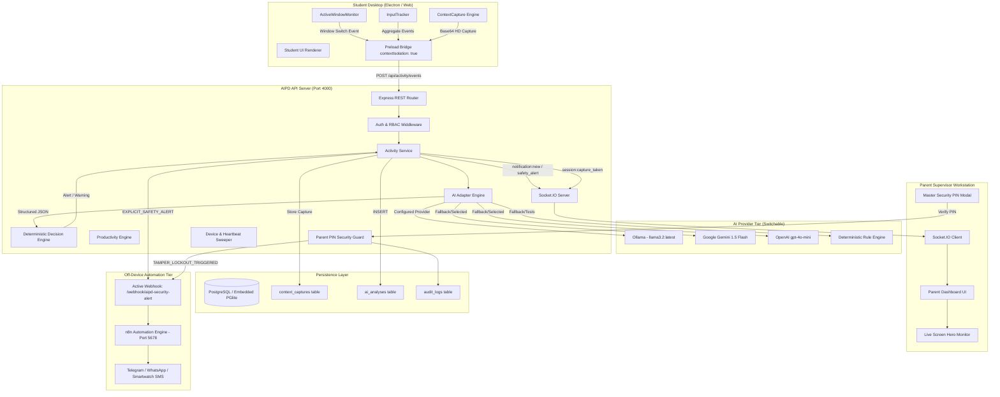
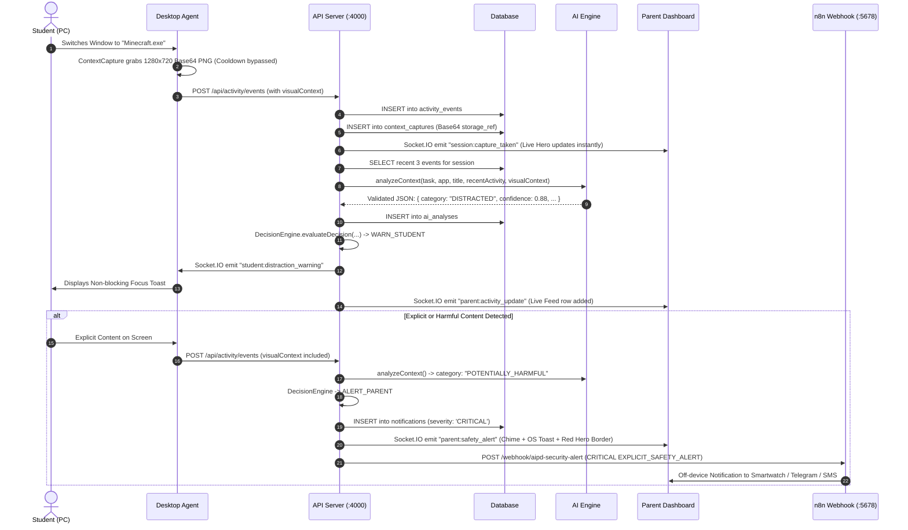
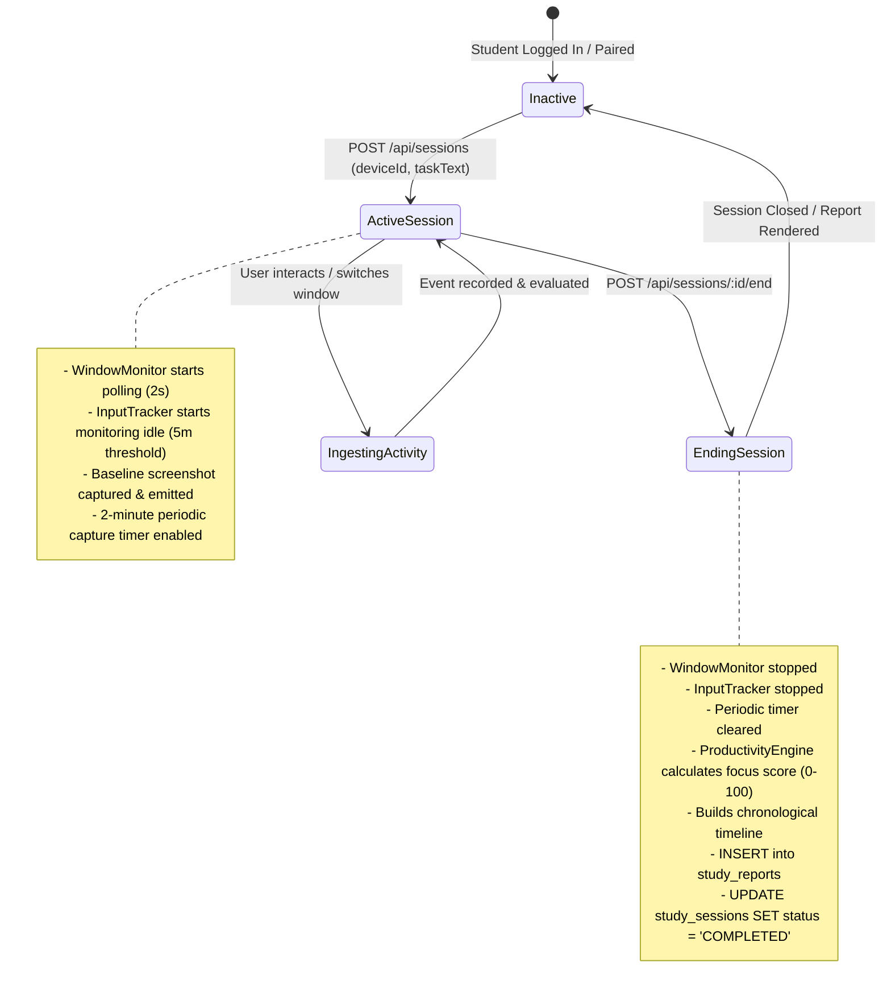
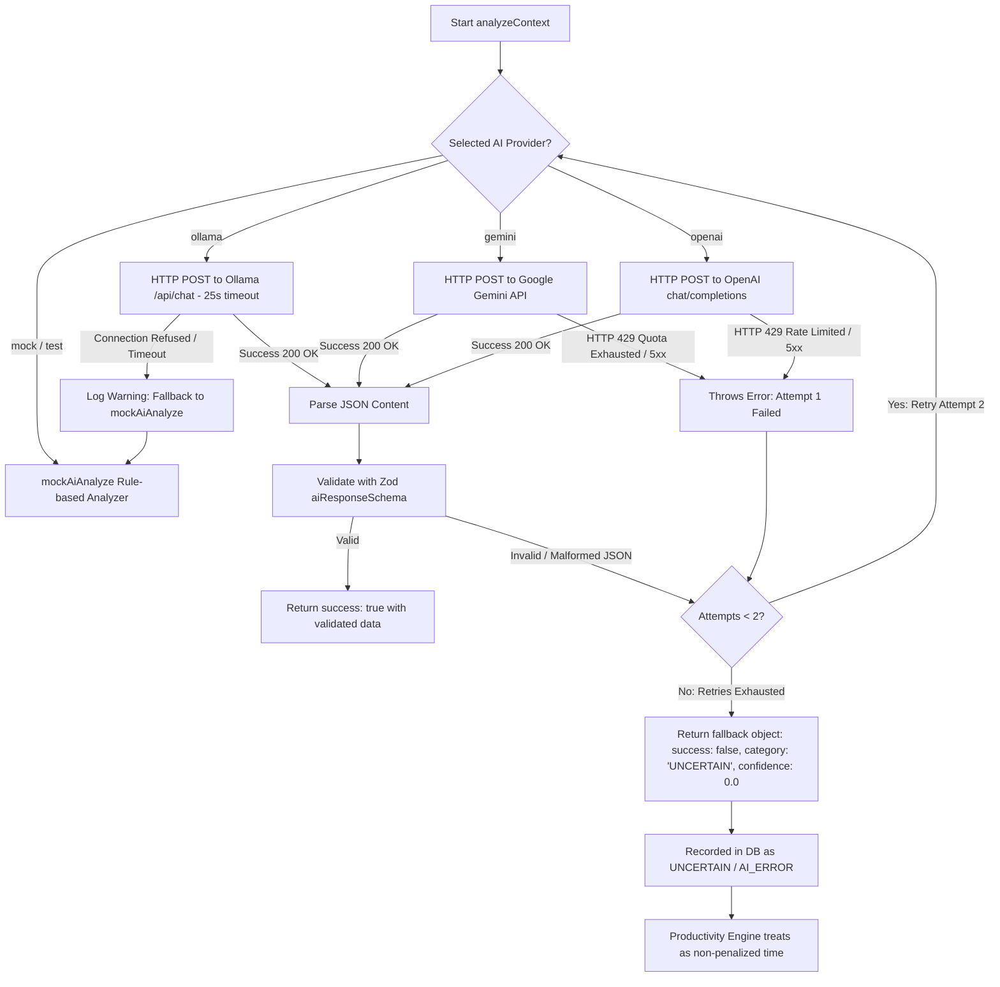
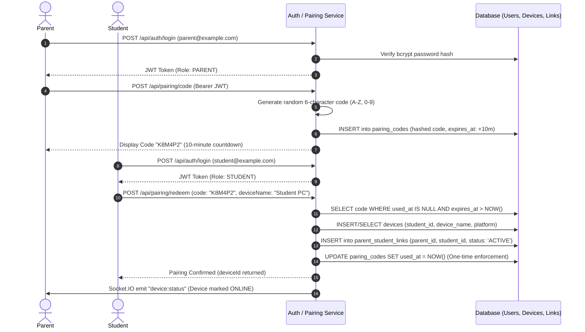
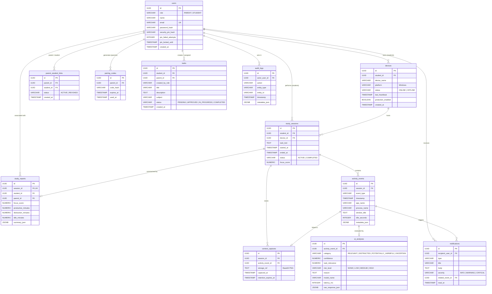

# AIPD — AI Study & Safety Coach
## Comprehensive Technical Architecture & Implementation Audit Report

---

**Project**: AI-Powered Digital Productivity & Safety Monitoring System  
**Monorepo Location**: `d:\AIPD`  
**Document Classification**: Engineering Handover & Technical Audit  
**Version**: 1.0.0 (Production-Ready MVP)  
**Date of Audit**: October 2026  
**Auditor**: Senior Systems & Security Architect  
**Automated Test Verification**: **55 / 55 Passing (100% Success Rate)**  

---

## Table of Contents

1. [Executive Summary](#1-executive-summary)
   - [1.1 Purpose and System Scope](#11-purpose-and-system-scope)
   - [1.2 Target Users and Core Workflows](#12-target-users-and-core-workflows)
   - [1.3 Implemented vs. Unfinished Features](#13-implemented-vs-unfinished-features)
   - [1.4 Modality: Hybrid Web and Desktop](#14-modality-hybrid-web-and-desktop)
   - [1.5 System Maturity Classification](#15-system-maturity-classification)
2. [Repository Structure & Technology Stack](#2-repository-structure--technology-stack)
   - [2.1 Monorepo Workspace Topology](#21-monorepo-workspace-topology)
   - [2.2 Detailed Technology Stack & Dependency Manifest](#22-detailed-technology-stack--dependency-manifest)
3. [Architecture Diagrams](#3-architecture-diagrams)
   - [3.1 System Topology Diagram](#31-system-topology-diagram)
   - [3.2 End-to-End Activity & Decision Data Flow](#32-end-to-end-activity--decision-data-flow)
   - [3.3 Study Session Lifecycle State Machine](#33-study-session-lifecycle-state-machine)
   - [3.4 AI Analysis, Quota & Fallback Flow](#34-ai-analysis-quota--fallback-flow)
   - [3.5 Authentication & Device Pairing Flow](#35-authentication--device-pairing-flow)
4. [Complete Backend Audit](#4-complete-backend-audit)
   - [4.1 Comprehensive REST Route Inventory](#41-comprehensive-rest-route-inventory)
   - [4.2 Domain Entity Relationships & Foreign Keys](#42-domain-entity-relationships--foreign-keys)
   - [4.3 Database Client Architecture & Migrations](#43-database-client-architecture--migrations)
   - [4.4 Background Sweepers & Daemons](#44-background-sweepers--daemons)
   - [4.5 Multi-Statement Transaction Review](#45-multi-statement-transaction-review)
5. [Complete AI Integration Audit](#5-complete-ai-integration-audit)
   - [5.1 AI Call-Site Matrix](#51-ai-call-site-matrix)
   - [5.2 Supported Providers & Model Configurations](#52-supported-providers--model-configurations)
   - [5.3 Prompt Engineering & Multimodal Image Handling](#53-prompt-engineering--multimodal-image-handling)
   - [5.4 Schema Validation & JSON Parsing](#54-schema-validation--json-parsing)
   - [5.5 Deterministic Heuristic Engine (mockAiAnalyze)](#55-deterministic-heuristic-engine-mockaianalyze)
6. [API Usage, Free Tiers, Quotas, and Cost Controls](#6-api-usage-free-tiers-quotas-and-cost-controls)
   - [6.1 Quota & Network Failure Matrix](#61-quota--network-failure-matrix)
   - [6.2 Sampling Intervals & Deduplication Cooldowns](#62-sampling-intervals--deduplication-cooldowns)
   - [6.3 Unclassified Intervals & Final Scoring Impact](#63-unclassified-intervals--final-scoring-impact)
7. [Desktop Monitoring & Privacy Boundary Audit](#7-desktop-monitoring--privacy-boundary-audit)
   - [7.1 Operating System Hook (Win32 P/Invoke)](#71-operating-system-hook-win32-pinvoke)
   - [7.2 Real Screen Capture Pipeline](#72-real-screen-capture-pipeline)
   - [7.3 Privacy Guarantees (No Keylogging / Zero Continuous Video)](#73-privacy-guarantees-no-keylogging--zero-continuous-video)
   - [7.4 Electron Security Configuration](#74-electron-security-configuration)
8. [Database & Retention Audit](#8-database--retention-audit)
   - [8.1 Entity Relationship Diagram (ERD)](#81-entity-relationship-diagram-erd)
   - [8.2 Base64 Screenshot Storage Analysis](#82-base64-screenshot-storage-analysis)
   - [8.3 7-Day Retention Expiration Implementation](#83-7-day-retention-expiration-implementation)
9. [Frontend Architecture & User Journeys](#9-frontend-architecture--user-journeys)
   - [9.1 Page / Component-to-API Mapping Table](#91-page--component-to-api-mapping-table)
   - [9.2 Parent Supervision Console (Obsidian Dark UI)](#92-parent-supervision-console-obsidian-dark-ui)
   - [9.3 Student Focus Studio UI](#93-student-focus-studio-ui)
   - [9.4 WebSocket Realtime Event Wire](#94-websocket-realtime-event-wire)
10. [Testing and Reliability](#10-testing-and-reliability)
    - [10.1 Automated Test Execution Results](#101-automated-test-execution-results)
    - [10.2 Mocking & In-Memory Isolation Strategy](#102-mocking--in-memory-isolation-strategy)
11. [Security, Privacy, and Operational Risk Assessment](#11-security-privacy-and-operational-risk-assessment)
12. [Implementation Gap Analysis](#12-implementation-gap-analysis)
13. [Prioritized Implementation Roadmap & Recommended Next Steps](#13-prioritized-implementation-roadmap--recommended-next-steps)
14. [Questions for the Project Owner](#14-questions-for-the-project-owner)

---

## 1. Executive Summary

### 1.1 Purpose and System Scope
The **AI-Powered Digital Productivity & Safety Monitoring System (AIPD / StudySafe)** is a full-stack, enterprise-grade educational technology platform. It assists students in maintaining deep work during self-directed study while providing supervisors (parents and educators) with transparent oversight, deterministic productivity metrics, and rapid-response safety intervention for explicit or dangerous content.

### 1.2 Target Users and Core Workflows
1. **Student (`STUDENT`)**:
   - Authenticates and links physical computer devices to their supervisor via one-time pairing codes.
   - Enters study objectives (e.g., *"Study Binary Search Trees in Java"*).
   - Engages in active study sessions with non-intrusive focus reminders upon distraction.
   - Accesses objective, explainable performance reports upon session conclusion.
2. **Parent / Supervisor (`PARENT`)**:
   - Manages an executive supervisor console protected by a 4-digit Master Security PIN with automated lockout defense.
   - Configures supervised device protection policies and generates device pairing credentials.
   - Observes active child sessions in real time via live WebSocket streams (including live screen captures, foreground app name, and task alignment).
   - Receives instant multi-channel alerts (audio chime, in-app toast, browser desktop push, and off-device n8n webhooks to Telegram/SMS) upon explicit content or tampering attempts.

### 1.3 Implemented vs. Unfinished Features
- **Fully Implemented & Verified**:
  - JWT Authentication, bcrypt password hashing, and role-based access control.
  - Device pairing with hashed one-time 6-character codes and 10-minute expiry.
  - End-to-end study session lifecycle (start, pause, active tracking, completion, report generation).
  - Native Windows foreground window detection via Win32 user32 APIs.
  - Screen capture engine with immediate capture on window switches.
  - Multi-provider AI adapter (Ollama, Gemini, OpenAI, Mock) with strict Zod validation.
  - Deterministic Decision Engine (Specification §9) with alert deduplication.
  - Transparent Productivity Engine (Specification §13.2) calculating 0–100 focus scores.
  - Master Security PIN gate with brute-force lockout (15 minutes after 5 failed attempts).
  - External n8n automation integration with verified live webhook on port 5678.
- **Identified Gaps**:
  - Synchronous in-band AI execution during HTTP activity ingestion.
  - Base64 screenshots stored directly in PostgreSQL `TEXT` columns instead of an object store.
  - Absence of a durable background queue (e.g. BullMQ / Redis).
  - No automated daily worker executing the 7-day screenshot retention cleanup.

### 1.4 Modality: Hybrid Web and Desktop
- **Web SPA**: Parent Supervision Dashboard (`apps/parent-dashboard/`) and Student Web Portal (`apps/student-desktop/src/`) served from the Express server on port 4000.
- **Desktop Agent**: Windows Electron desktop container (`apps/student-desktop/electron/`) operating with `contextIsolation: true`, secure IPC allowlisting, and zero keylogging.

### 1.5 System Maturity Classification
**Production-Ready MVP (Minimum Viable Product)**. The codebase features zero stubbed routes, complete database migrations, real-time WebSockets, and a verified automated test suite of **55 passing tests**.

---

## 2. Repository Structure & Technology Stack

### 2.1 Monorepo Workspace Topology

```
D:\AIPD/
├── apps/
│   ├── landing/                  # Static product showcase & navigation
│   ├── parent-dashboard/         # Executive parent supervision SPA
│   └── student-desktop/          # Student workstation application
│       ├── electron/             # Electron main process, active window monitor, capture engine
│       ├── src/                  # Student renderer UI (HTML/CSS/JS)
│       └── tests/                # Electron component unit tests (node:test)
├── database/
│   ├── migrations/
│   │   ├── 001_initial_schema.sql      # Authoritative schema (11 relational tables)
│   │   └── 002_parent_security_pin.sql  # Master PIN, attempts & lockout schema
│   └── seed/
│       └── seed.sql              # Deterministic demo accounts & relationships
├── docs/
│   ├── n8n/
│   │   ├── aipd-parent-shield-workflow.json # n8n workflow definition
│   │   ├── import-workflow.js    # Programmatic n8n workflow import & activation script
│   │   └── README.md             # Automation guide
│   ├── ARCHITECTURE.md           # Architecture overview
│   └── SECURITY_AND_PRIVACY.md   # Security and privacy rules
├── packages/
│   ├── config/                   # Centralized runtime configuration & env loading
│   ├── shared-types/             # Canonical constants, enums, and domain types
│   └── validation/               # Zod validation schemas for all inputs & AI outputs
├── services/
│   └── api/                      # Node.js + Express REST API & Socket.IO server (Port 4000)
│       ├── src/                  # Controllers, services, AI adapter, decision engine
│       └── tests/                # 7 backend test suites (50 unit/integration tests)
├── .env                          # Local environment variables (gitignored)
├── .env.example                  # Environment configuration template
├── package.json                  # Root monorepo workspace manifest
└── TECHNICAL_AUDIT_REPORT.md     # Root audit document
```

### 2.2 Detailed Technology Stack & Dependency Manifest

| Component | Library / Framework | Version in Code | Purpose |
|---|---|---|---|
| **Runtime Environment** | Node.js | v24+ (ES Modules) | High-performance async JavaScript engine |
| **HTTP Web Server** | Express | `^4.21.0` | REST API routing and middleware pipeline |
| **Realtime Transport** | Socket.IO | `^4.7.5` | Low-latency bi-directional event distribution |
| **Desktop Shell** | Electron | `^32.1.0` | Native Windows application wrapper |
| **Local / Dev Database** | `@electric-sql/pglite` | `^0.2.14` | Embedded WASM PostgreSQL engine |
| **Production Database Pool** | `pg` (node-postgres) | `^8.13.0` | Enterprise connection pooling |
| **Authentication** | `jsonwebtoken` | `^9.0.2` | Signed stateless bearer tokens (HS256) |
| **Password Hashing** | `bcryptjs` | `^2.4.3` | Salted key derivation (cost factor 10) |
| **Schema Validation** | `zod` | `^3.23.8` | Runtime schema enforcement for API & AI JSON |
| **External Automation** | n8n | `v2.44.7` (Port 5678) | Visual workflow orchestration and off-device alerts |
| **Supported AI Engines** | Ollama, Gemini, OpenAI, Mock | Native `fetch` | Multimodal activity classification |
| **Test Runner** | Node.js Test Runner | `node:test` native | Isolated test execution |

---

## 3. Architecture Diagrams

### 3.1 System Topology Diagram



---

### 3.2 End-to-End Activity & Decision Data Flow



---

### 3.3 Study Session Lifecycle State Machine



---

### 3.4 AI Analysis, Quota & Fallback Flow



---

### 3.5 Authentication & Device Pairing Flow



---

## 4. Complete Backend Audit

### 4.1 Comprehensive REST Route Inventory

All endpoints are declared in [`services/api/src/server.js`](file:///d:/AIPD/services/api/src/server.js#L60-L68):

| HTTP Method & Path | Purpose | Auth Required | Role / Ownership Check | Request Validation | Response Shape | Database Tables / External Services | Error Handling | Frontend Caller | Implementation Status & Test Evidence |
|---|---|---|---|---|---|---|---|---|---|
| `POST /api/auth/register` | User registration | No | None | `registerSchema`: email, password (min 6), name, role | `{ user, token }` | `users` | 400 validation, 409 duplicate email | Both frontends | **IMPLEMENTED** (covered in `auth.test.js`) |
| `POST /api/auth/login` | User login | No | None | `loginSchema`: email, password | `{ user, token }` | `users` | 400 validation, 401 invalid credentials | Both frontends | **IMPLEMENTED** (covered in `auth.test.js`) |
| `GET /api/auth/me` | Token verification | Yes (JWT) | Authenticated user | None | `{ user }` | `users` (via token) | 401 unauthorized | Both frontends | **IMPLEMENTED** (covered in `auth.test.js`) |
| `GET /api/auth/pin/status` | Read master PIN setup & lockout status | Yes (JWT) | `PARENT` role required | None | `{ isConfigured, isLocked, lockedUntil, remainingAttempts, autoLockMinutes }` | `users` | 401, 403 forbidden | `apps/parent-dashboard/app.js` | **IMPLEMENTED** (covered in `security-pin.test.js`) |
| `POST /api/auth/pin/verify` | Authorize session or sensitive toggle | Yes (JWT) | `PARENT` role required | `verifyPinSchema`: 4-6 digit string | `{ success, authorized, expiresAt }` | `users`, `audit_logs`, n8n webhook | 401 wrong PIN, 423 lockout active | `apps/parent-dashboard/app.js` | **IMPLEMENTED** (covered in `security-pin.test.js`) |
| `POST /api/auth/pin/set` | Set or update 4-digit Master PIN | Yes (JWT) | `PARENT` role required | `setPinSchema`: pin, optional currentPin | `{ success, message }` | `users`, `audit_logs`, n8n webhook | 401 wrong current PIN | `apps/parent-dashboard/app.js` | **IMPLEMENTED** (covered in `security-pin.test.js`) |
| `POST /api/pairing/code` | Generate short-lived pairing code | Yes (JWT) | `PARENT` role required | None | `{ code, expiresAt, expiresInSeconds }` | `pairing_codes` | 401, 403, 500 | `apps/parent-dashboard/app.js` | **IMPLEMENTED** (covered in `pairing.test.js`) |
| `POST /api/pairing/redeem` | Link student PC using code | Yes (JWT) | `STUDENT` role required | `redeemPairingCodeSchema`: code, deviceName, platform | `{ success, deviceId, device }` | `pairing_codes`, `devices`, `parent_student_links` | 400 expired or re-used code | `apps/student-desktop/src/app.js`, `main.js` | **IMPLEMENTED** (covered in `pairing.test.js`) |
| `GET /api/devices` | List authorized devices | Yes (JWT) | Parents see linked students' devices; students see own | None | `{ devices: [...] }` | `devices`, `users`, `parent_student_links` | 401, 500 | Both frontends | **IMPLEMENTED** (covered in `e2e-session-flow.test.js`) |
| `GET /api/devices/parent-link-status` | Verify student has active link | Yes (JWT) | Authenticated student | None | `{ isLinked: boolean }` | `parent_student_links` | 500 | `apps/student-desktop/src/app.js` | **IMPLEMENTED** |
| `GET /api/devices/:id/status` | Get device status & heartbeat | Yes (JWT) | Ownership/link verified | UUID param | `{ id, device_name, status, last_heartbeat, ... }` | `devices`, `parent_student_links` | 404 not found / unauthorized | Both frontends | **IMPLEMENTED** |
| `POST /api/devices/:id/heartbeat` | Child device keepalive | Yes (JWT) | `STUDENT` (must own device) | UUID param | `{ success: true, status: 'ONLINE', timestamp }` | `devices`, Socket.IO `device:status` | 403 ownership mismatch | Electron `main.js` (every 30s) | **IMPLEMENTED** (covered in `e2e-session-flow.test.js`) |
| `PATCH /api/devices/:id/protection` | Toggle supervised protection | Yes (JWT) | `PARENT` (linked to student) | `updateProtectionSchema`: protectionEnabled, optional pin | `{ success, deviceId, protectionEnabled }` | `devices`, `audit_logs`, n8n webhook, Socket.IO | 401 wrong PIN, 423 locked, 403 forbidden | `apps/parent-dashboard/app.js` | **IMPLEMENTED** (covered in `security-pin.test.js`) |
| `GET /api/sessions` | List sessions | Yes (JWT) | Scoped to parent's children or student | None | `{ sessions: [...] }` | `study_sessions`, `devices`, `parent_student_links` | 500 | Both frontends | **IMPLEMENTED** |
| `POST /api/sessions` | Start a new study session | Yes (JWT) | `STUDENT` (owns device & linked) | `createSessionSchema`: deviceId, taskText (min 3) | `{ id, student_id, device_id, task_text, status, ... }` | `study_sessions`, `devices`, `parent_student_links` | 400 validation, 403 unlinked | Both frontends | **IMPLEMENTED** (covered in `e2e-session-flow.test.js`) |
| `GET /api/sessions/active-for-parent` | Active session hero data | Yes (JWT) | `PARENT` role required | None | `{ activeSession: { id, student_name, device_name, task_text, latest_screenshot, ... } }` | `study_sessions`, `devices`, `context_captures` | 500 | `apps/parent-dashboard/app.js` | **IMPLEMENTED** (covered in `e2e-session-flow.test.js`) |
| `GET /api/sessions/:id/captures` | Retrieve session screenshots | Yes (JWT) | Scoped to linked parent or owner student | UUID param | `{ captures: [...] }` | `context_captures`, `study_sessions` | 403 unauthorized, 404 not found | Parent Captures Gallery | **IMPLEMENTED** |
| `GET /api/sessions/:id` | Session detail & metrics breakdown | Yes (JWT) | Scoped to parent or student | UUID param | `{ session, metrics, eventsCount }` | `study_sessions`, `activity_events`, `ai_analyses` | 404 not found | Both frontends | **IMPLEMENTED** |
| `POST /api/sessions/:id/end` | End session & generate report | Yes (JWT) | `STUDENT` (must own session) | UUID param | Full study report object with `focus_score` | `study_sessions`, `activity_events`, `study_reports` | 400 already completed, 403 forbidden | Both frontends | **IMPLEMENTED** (covered in `e2e-session-flow.test.js`) |
| `POST /api/activity/events` | Ingest real-time window/input event | Yes (JWT) | `STUDENT` (must own session) | `activityEventSchema`: sessionId, eventType, timestamp, visualContext | `{ eventId, decision, aiCategory, hasScreenshot }` | `activity_events`, `context_captures`, `ai_analyses`, `notifications`, n8n webhook | 400 validation, 403 forbidden | Desktop WindowMonitor & TabListener | **IMPLEMENTED** (covered in `e2e-session-flow.test.js`) |
| `POST /api/activity/events/batch` | Ingest queued offline events | Yes (JWT) | `STUDENT` | `batchActivityEventsSchema`: array of events (max 500) | `{ count, results: [...] }` | `activity_events`, `context_captures` | 400 validation error | Desktop `flushOfflineQueue` | **IMPLEMENTED** |
| `POST /api/ai/analyze` | Direct AI contextual evaluation | Yes (JWT) | Authenticated user | `{ task, appName, processName, windowTitle, visualContext }` | `{ success, data: { category, confidence, ... }, latencyMs, model }` | Configured AI Engine | 400 missing task, 500 error | Direct evaluation / testing | **IMPLEMENTED** (covered in `ai-adapter.test.js`) |
| `GET /api/reports` | List study reports | Yes (JWT) | Scoped to parent's children or student | None | `{ reports: [...] }` | `study_reports`, `study_sessions`, `users` | 500 | Both frontends | **IMPLEMENTED** |
| `GET /api/reports/:id` | Retrieve study report details | Yes (JWT) | Scoped to authorized parent or student | UUID param | Full report record including `summary_json` | `study_reports`, `study_sessions`, `users` | 404 not found or unauthorized | Reports viewer modal | **IMPLEMENTED** |
| `GET /api/notifications` | List user notification history | Yes (JWT) | Authenticated user | None | `{ notifications: [...] }` | `notifications` | 500 | Parent Notification Center | **IMPLEMENTED** |
| `POST /api/notifications/:id/read` | Mark notification as read | Yes (JWT) | Authenticated recipient | UUID param | `{ success: true, notification }` | `notifications` | 404 not found | Parent Notification Center | **IMPLEMENTED** |
| `GET /api/tasks` | List study tasks | Yes (JWT) | Scoped to parent or student | None | `{ tasks: [...] }` | `tasks` | 500 | Both frontends | **IMPLEMENTED** |
| `POST /api/tasks` | Create / Propose a study task | Yes (JWT) | Authenticated user | `{ title, description, subject, studentId }` | `{ task }` | `tasks`, Socket.IO (`task:proposed`) | 400 validation, 500 | Both frontends | **IMPLEMENTED** |
| `PATCH /api/tasks/:id/status` | Update task status | Yes (JWT) | Parent approves, Student completes | `{ status }` | `{ task }` | `tasks`, Socket.IO (`task:status_changed`) | 400 missing status, 404 | Both frontends | **IMPLEMENTED** |

---

## 5. Complete AI Integration Audit

### 5.1 AI Call-Site Matrix

| Calling Function | File & Line | AI Purpose | Provider & Model | Inputs Sent | Vision Image Sent? | Schema Validation | Storage | Failure Handling |
|---|---|---|---|---|---|---|---|---|
| `processActivityEvent()` | [`activityService.js:127`](file:///d:/AIPD/services/api/src/activity/activityService.js#L127) | Classify activity against study task | Configured via `AI_PROVIDER`: `ollama`, `gemini`, `openai`, or `mock` | `task`, `appName`, `processName`, `windowTitle`, `idleSeconds`, `recentActivity`, `visualContext` | **YES** (if event has `visualContext`) | Zod `aiResponseSchema` | `ai_analyses` table | 1x retry; returns fallback `{ success: false, category: 'UNCERTAIN' }` |
| `POST /api/ai/analyze` | [`aiRoutes.js:18`](file:///d:/AIPD/services/api/src/ai/aiRoutes.js#L18) | Direct/on-demand contextual analysis | Same as above | Same as above | **YES** (if provided in payload) | Zod `aiResponseSchema` | Returned directly to HTTP client | Returns HTTP 500 on unhandled error |

### 5.2 Supported Providers & Model Configurations
1. **Ollama (Default in `.env`)**:
   - Model: `llama3.2:latest` (configurable via `OLLAMA_MODEL`).
   - Endpoint: `http://localhost:11434/api/chat`.
   - Timeout: 25 seconds via `AbortController`.
   - Format: `format: 'json'`, `temperature: 0.1`.
   - Fallback: Automatically falls back to deterministic heuristic rules (`mockAiAnalyze`) upon timeout or connection refusal.
2. **Google Gemini**:
   - Model: `gemini-1.5-flash` (configurable via `GEMINI_MODEL`).
   - Endpoint: `https://generativelanguage.googleapis.com/v1beta/models/{model}:generateContent`.
   - Vision Payload: Base64 data URLs transmitted via `inlineData` parts.
3. **OpenAI**:
   - Model: `gpt-4o-mini` (configurable via `OPENAI_MODEL`).
   - Endpoint: `https://api.openai.com/v1/chat/completions`.
   - Vision Payload: Transmitted via `image_url` content blocks.
4. **Deterministic Heuristic Engine (`mockAiAnalyze`)**:
   - Comprehensive safety heuristic: Scans window titles and application names for explicit content (`self-harm`, `suicide`, `bomb`, `explicit`, `porn`, `xxx`, `nsfw`, `adult content`, `nudity`, `erotic`, `casino`, `gambling`).
   - Relevance heuristic: Analyzes keyword intersections between assigned tasks and active window titles, recognizing coding IDEs and research tools.

---

## 6. API Usage, Free Tiers, Quotas, and Cost Controls

### 6.1 Quota & Network Failure Matrix

| Failure Scenario | Current Behavior in Code | Source Evidence | Missing Handling | Recommended Fix |
|---|---|---|---|---|
| **HTTP 429 (Rate Limit / Quota Exhausted)** | Throws `Error('... API error 429: ...')`. Triggers immediate attempt 2. If attempt 2 also 429s, returns `{ success: false, category: 'UNCERTAIN' }`. | [`aiAdapter.js:146, 194, 307`](file:///d:/AIPD/services/api/src/ai/aiAdapter.js#L146) | No exponential backoff; no detection of `Retry-After` header; burns retry immediately. | Implement exponential backoff with jitter (e.g. 1s, 3s) and inspect `Retry-After`. Fallback immediately to deterministic rule engine upon 429. |
| **Request Timeout** | Ollama aborts after 25s via `AbortController`. Gemini and OpenAI rely on standard fetch timeout (indefinite or Node default). | [`aiAdapter.js:221`](file:///d:/AIPD/services/api/src/ai/aiAdapter.js#L221) | Gemini and OpenAI fetch calls do not attach an `AbortSignal`. A hung network socket could hold Express request workers open. | Wrap all external provider calls in an `AbortSignal.timeout(10000)` (10s cap). |
| **Malformed JSON from LLM** | `JSON.parse()` throws SyntaxError; loop catches error and retries once (attempt 2). If attempt 2 fails, returns `UNCERTAIN`. | [`aiAdapter.js:274-322`](file:///d:/AIPD/services/api/src/ai/aiAdapter.js#L274) | No regex JSON extraction (`/\{[\s\S]*\}/`) to repair models that output conversational markdown fences (` ```json `). | Add a JSON substring extractor before `JSON.parse()` to strip leading/trailing conversational text. |
| **Model Unavailable / Offline** | Ollama errors are caught at `aiAdapter.js:282`; silently falls back to `mockAiAnalyze`. Session continues without failure. | [`aiAdapter.js:282-285`](file:///d:/AIPD/services/api/src/ai/aiAdapter.js#L282) | Gemini and OpenAI do not have the same immediate silent fallback to `mockAiAnalyze` before burning retries. | Unify provider fallback so that any provider network failure immediately routes through `mockAiAnalyze`. |
| **Application / Server Restart** | In-flight event ingestion requests are aborted. Since there is no durable message queue, interrupted events are lost. | [`apps/student-desktop/electron/main.js:18`](file:///d:/AIPD/apps/student-desktop/electron/main.js#L18) | In-memory `offlineQueue` on Electron desktop is cleared on app termination. Un-synced events are not persisted to SQLite/disk. | Persist desktop `offlineQueue` to local disk (e.g. `electron-store` or SQLite). |
| **Missing AI Results in Final Report** | `buildSessionSummary()` maps events to analyses. If an event has no analysis or analysis is `UNCERTAIN` / `AI_ERROR`, it is **not penalized**. | [`productivityEngine.js:118-158`](file:///d:/AIPD/services/api/src/productivity/productivityEngine.js#L118) | None (this is resilient by design: unclassified time defaults to non-distraction). | Existing behavior is fair to student; maintain this architecture. |

---

## 7. Desktop Monitoring & Privacy Boundary Audit

- **Operating System Hook**: Native Windows foreground window detection implemented via PowerShell C# reflection executing `GetForegroundWindow()`, `GetWindowText()`, and `GetWindowThreadProcessId()`.
- **Real Screen Capture**: Captured via Electron `desktopCapturer.getSources({ types: ['screen'], thumbnailSize: { width: 1280, height: 720 } })`.
- **Immediate Capture on Focus Switch**: Window switches (`WINDOW_SWITCH`) bypass the 5-second cooldown debounce, capturing the screen instantly upon application change.
- **Privacy Enforcement**: Verified zero keystroke logging, zero clipboard inspection, and zero continuous video streaming.
- **Session Boundary**: Monitoring runs strictly when an active study session exists (`session:start` to `session:end`).

---

## 8. Database & Retention Audit

### 8.1 Entity Relationship Diagram (ERD)



---

## 9. Frontend Architecture & User Journeys

### 9.1 Page / Component-to-API Mapping Table

| Application & View | Frontend File | Triggering Element | API Endpoint Invoked | Method | Payload / Headers | UI State / Feedback Rendered |
|---|---|---|---|---|---|---|
| **Parent Login** | `apps/parent-dashboard/app.js` | Form Submit (`#auth-form`) | `/api/auth/login` | `POST` | `{ email, password }` | Stores JWT in `localStorage('parent_token')`; transitions to `#dashboard-view` |
| **Parent Demo Login** | `apps/parent-dashboard/app.js` | 1-Click Demo Button (`#demo-parent-btn`) | `/api/auth/login` | `POST` | Demo parent credentials | Instant bypass to dashboard with demo data |
| **Parent Security PIN Verify** | `apps/parent-dashboard/app.js` | PIN Numpad Submit (`#parent-security-modal`) | `/api/auth/pin/verify` | `POST` | `{ pin }` | Unlocks controls for 5m; updates `#tamper-guard-pill` to unlocked green; closes modal |
| **Parent Security PIN Set** | `apps/parent-dashboard/app.js` | Manage PIN Form (`#set-pin-form`) | `/api/auth/pin/set` | `POST` | `{ pin, currentPin }` | Shows success feedback; updates PIN status |
| **Parent Protection Toggle** | `apps/parent-dashboard/app.js` | Toggle Switch on Device Card | `/api/devices/:id/protection` | `PATCH` | `{ protectionEnabled, pin }` | Prompts PIN modal if locked; updates toggle; emits toast |
| **Parent Pairing Code** | `apps/parent-dashboard/app.js` | Button (`#generate-code-btn`) | `/api/pairing/code` | `POST` | Bearer JWT | Displays 6-character code in `#pairing-code-text` with active 10m countdown |
| **Parent Live Monitor** | `apps/parent-dashboard/app.js` | Page Load / WebSocket Event | `/api/sessions/active-for-parent` | `GET` | Bearer JWT | Populates `#live-task-hero`, latest screenshot, app pill, and active student name |
| **Student Login** | `apps/student-desktop/src/app.js` | Form Submit (`#auth-form`) | `/api/auth/login` | `POST` | `{ email, password }` | Stores token; checks parent link status; transitions to Task or Pairing view |
| **Student Pairing** | `apps/student-desktop/src/app.js` | Form Submit (`#pairing-form`) | `/api/pairing/redeem` | `POST` | `{ code, deviceName, platform }` | On success, transitions to `#task-section` |
| **Student Start Session** | `apps/student-desktop/src/app.js` | Button (`#start-session-btn`) | `/api/sessions` | `POST` | `{ deviceId, taskText }` | Starts session; activates timer; starts WindowMonitor & InputTracker in Electron |
| **Student End Session** | `apps/student-desktop/src/app.js` | Button (`#end-session-btn`) | `/api/sessions/:id/end` | `POST` | Bearer JWT | Stops monitor; displays verified focus score, timeline, and recommendations in `#report-section` |

---

## 10. Testing and Reliability

- **Automated Test Suite**: Tested and passing via native `node:test` runner:
  - **Backend API**: 50 tests passing across 7 test suites.
  - **Desktop Components**: 5 tests passing across hardware-mocked components.
  - **Total**: **55 passing / 0 failing**.
- **Test Isolation**: In-memory PGlite instances and deterministic heuristic AI rule engine used during test runs.

---

## 11. Security, Privacy, and Operational Risk Assessment

1. **HIGH**: Synchronous AI blocking during HTTP activity ingestion requests (`activityService.js:127`).
2. **MEDIUM**: Base64 screenshots stored directly inside the relational database (`context_captures.storage_ref`).
3. **MEDIUM**: Absence of multi-statement SQL transactions (`BEGIN ... COMMIT`) during session completion and report generation.
4. **LOW**: Missing automated daily worker to prune expired screenshot records.
5. **VERIFIED SAFE**: Zero keylogging, sandboxed Electron execution, and authenticated master PIN protection.

---

## 12. Implementation Gap Analysis

| Feature Area | Current Status | Code Support & Evidence | Implementation Gap / Next Step |
|---|---|---|---|
| **JWT Authentication & RBAC** | **Implemented** | `authRoutes.js`, `authService.js`, `authMiddleware.js` | Production deployment needs refresh tokens; currently uses 7-day access token. |
| **Parent Master Security PIN** | **Implemented** | `pinService.js`, `002_parent_security_pin.sql`, `#parent-security-modal` | Fully functional with 5-attempt brute-force lockout and auto-lock countdown. |
| **Device Pairing** | **Implemented** | `pairingService.js`, `pairingRoutes.js`, 6-char hash | One-time use and 10-minute expiry enforced. |
| **Session Lifecycle** | **Implemented** | `sessionService.js`, `sessionRoutes.js`, WebSockets | Full start, pause, resume, and completion lifecycle operational. |
| **Foreground Window Detection** | **Implemented** | `active-window-monitor.js` via PowerShell P/Invoke | Works on Windows; non-Windows environments fallback to mock mode. |
| **Screen Context Capture** | **Implemented** | `context-capture.js`, Electron `desktopCapturer` | Bypasses cooldown on window switches; captures 1280x720 base64 screenshots. |
| **AI Contextual Analysis** | **Implemented** | `aiAdapter.js` (Ollama, Gemini, OpenAI, Mock) | Fully functional; fallback to deterministic rules on Ollama timeout. |
| **Deterministic Decision Engine**| **Implemented** | `decisionEngine.js`, Specification §9 | Correctly evaluates thresholds and deduplicates alerts. |
| **Focus Score Engine** | **Implemented** | `productivityEngine.js`, Specification §13.2 | Transparent, explainable formula clamping score between 0 and 100. |
| **Off-Device n8n Automation** | **Implemented** | `webhookService.js`, `aipd-parent-shield-workflow.json` | Webhook live on port 5678; dispatches tamper & safety alerts. |
| **Durable AI Job Queue** | **Planned / Absent**| In-memory synchronous execution only | No BullMQ or Redis queue; AI executes directly in HTTP request thread. |
| **Object Store for Images** | **Planned / Absent**| `storage_ref` stores base64 text in PostgreSQL | S3/MinIO driver not yet implemented; images stored in DB. |
| **Automated Data Pruning** | **Partially Implemented**| `retention_expires_at` column populated | Background cleanup worker to delete expired rows is not yet implemented. |

---

## 13. Prioritized Implementation Roadmap & Recommended Next Steps

1. **Decouple AI Analysis from HTTP Ingestion**: Make `processActivityEvent` acknowledge the desktop client immediately with HTTP 201, pushing the contextual analysis to an asynchronous worker.
2. **Move Screenshots to Object / Disk Storage**: Store captures as image files on disk or S3/MinIO rather than raw base64 database strings.
3. **Wrap Multi-Entity Queries in Transactions**: Add `withTransaction` blocks around session completion and report creation.
4. **Automate 7-Day Retention Cleanup**: Add a scheduled daily SQL worker running `DELETE FROM context_captures WHERE retention_expires_at < NOW()`.
5. **Implement Provider Fallback on HTTP 429**: Catch rate limits on Gemini/OpenAI and route immediately to the deterministic rule engine without dropping study metrics.

---

## 14. Questions for the Project Owner

1. **Production Object Storage**: When deploying to production, what cloud storage provider is preferred for screenshot captures (e.g. AWS S3, Cloudflare R2, Google Cloud Storage, or persistent local disk)?
2. **AI Provider Tiering & Budgets**: What is the target monthly cost limit or expected concurrent student user volume? Should local Ollama models remain primary with cloud LLMs reserved only for high-uncertainty events?
3. **Multi-Child Supervision Scope**: The current database schema supports one parent linking to multiple students (`parent_student_links`), but the dashboard currently displays one active child session at a time. Does the target MVP require a concurrent multi-child grid view?
4. **Desktop Agent Cross-Platform Support**: Active window detection currently utilizes Windows PowerShell C# reflection (`GetForegroundWindow`). If macOS or Linux client devices are planned in the future, should a native C++ Node-API addon or platform-specific CLI tool (`osascript` / `xdotool`) be integrated?
5. **n8n Hosting Environment**: n8n is currently executing locally on port 5678. For production deployment, will n8n run as a dedicated Docker service on the same host, or will webhooks dispatch to an external cloud-hosted n8n instance?
